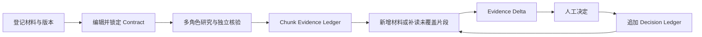
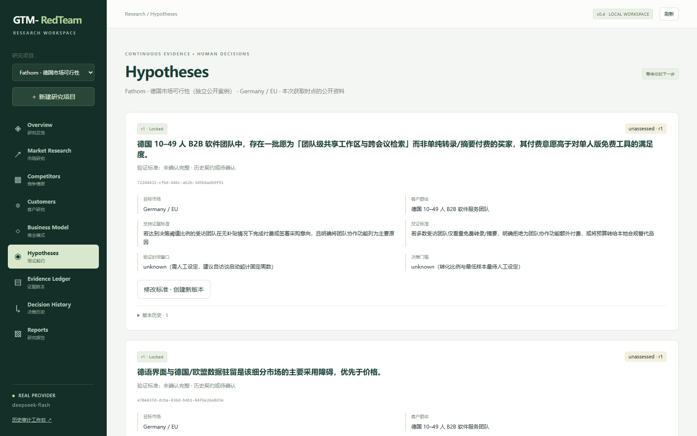
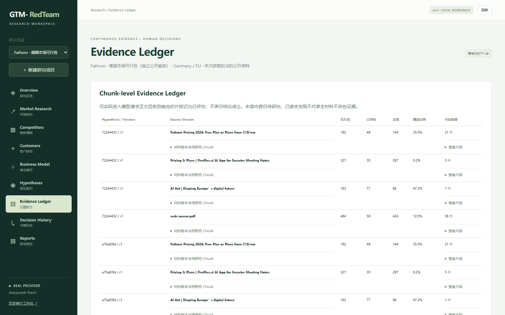

# GTM-RedTeam

**A persistent evidence ledger for go-to-market decisions.**

> **[查看真实 DeepSeek 双轮公开案例报告 →](outputs/Public-data-Case-Report.md)**
> Public-data Case：15 次真实请求，保留失败与引用记录；不是客户验证。

面向早期 AI/SaaS 团队的商业假设研究、持续证据追踪与决策工作空间。以锁定假设为单位，保留材料版本、实际读取片段、独立核验与人工决定。

## 真实解决的问题

竞品价格、访谈和市场材料不断变化。哪些假设得到支持或反驳？哪些内容还没读？上次为什么作出那个决定？GTM-RedTeam 将这些记录连接起来，供团队持续复核。

## 核心工作流



## Hypothesis Contract

明确市场、客户、指标、方法、成功条件、失败条件、窗口和门槛。结构化完整性与证据方向分开。锁定后只能升版。报告分别展示 **Historical Research Context** 和 **Current Hypothesis State**；历史运行始终使用冻结契约及材料版本。旧锁定 JSON 保留原样，新完整性确认尚未完成时如实提示。

## Multi-Agent Research

复用 Planner、Market、Competitor、Customer、Business、Red-Team、Verifier、Decision。领域角色在当前假设的词法相关性基础上使用不同研究权重和输入窗口，保留来源多样性和相邻上下文。Business 同时负责监管与运营风险。Red-Team 质询原始交接记录；Verifier 独立检查引用完整性、语义支持和证据分类；Decision 只接收核验结果，无权改正式状态。这些是同一真实模型的独立执行，不代表八个独立模型。

## Chunk-level Evidence Ledger

覆盖范围为 `(hypothesis_id, hypothesis_version, source_id, source_version, chunk_id)`，记录内容 Hash、Run、调用、时间和角色。完整片段发入请求且收到 Provider 响应后才记入覆盖；仅检索选中、Verifier 局部摘录和未确认送达的失败请求不计为完整片段已评估。进入上下文不表示结论正确。

每个角色最多 20 个窗口／48,000 字符，原件完整保留。UI 与报告区分 `evaluated_chunks`、`unread_chunks_remaining`、`coverage_ratio` 和本轮新增读取。同版本 Delta 优先选择未覆盖 Chunk；契约或材料升版形成新范围。旧文件级标记不被冒充为片段覆盖。

`not_found_in_read_chunks` 仅描述已读片段，未读内容仍可能含关键反证。

## Evidence Delta

新增支持／反对证据经独立核验后才产生人工状态建议。无关、背景、重复和无新增发现只形成观察记录。重复引用保留关联但不计为新增证据。Delta 保留 Red-Team → Verifier → Decision 短链路；完整研究负责领域分工。

## Decision Ledger

人工接受、拒绝、进一步研究、契约修改／锁定、新增证据和研究评估追加到 JSON 哈希链，不覆盖历史；保留版本、Run／Delta 关联和操作者。AI 提议，人工决定。支持 Markdown 报告和 JSON 导出。

## 产品真实界面

截图来自本地真实公开资料案例，结论仍须人工核验。




## 公开案例与报告

本轮以 Fathom、Fireflies 官方定价、欧盟委员会 AI Act 页面和 Eurostat PDF 演示双轮研究。**Public-data Case**，不是 Customer Pilot，也不表示相关公司委托研究。来源保留 URL、获取时间、Hash 和位置；未声明发布日期时保持 unknown。

见 [本轮验收](docs/validation/pilot-readiness-2026-11-15.md) 和 [案例报告](examples/public-data-pilot/REPORT.md)。不推断真实付费意愿、准确率、CAC/LTV 或节省时间。真实团队试用和人工商业核验尚未完成。

## 安装和运行

需要 Node.js 22.13+，本地使用 Node 24。

```powershell
npm ci
# 将 .env.example 复制为 .env.gtm.local，在本机填写配置
npm run check:gtm-config
npm run build
npm start
```

打开 [本地工作区](http://127.0.0.1:4317/)。导入资料 → 草拟／编辑／锁定契约 → 勾选材料外发授权 → 研究 → Evidence Ledger → 新材料／Delta → 人工决定 → Reports。

隔离试点可设置 `GTM_DATA_DIR` 和 `GTM_PORT`，例如 `work/pilot/data` 与 `4318`。重启不自动重发请求。见 [Pilot Guide](docs/PILOT-GUIDE.md)。

## DeepSeek 配置

复用本机配置文件；Provider、地址、模型和密钥字段见 `.env.example`。密钥仅由 Provider 读取，不输出、不提交。无效配置阻止启动，不回退 Mock。每次研究须明确材料外发授权。

同项目、运行类型、契约／材料／选中范围共享 **16 次请求预算**，失败、修复和恢复均计入；重复启动相同范围不获得新额度。真实 usage 缺失则为 unknown；估算与实际 Token 分开。截断、无效 JSON 和引用失败保留为失败。DeepSeek 结构化请求显式禁用 thinking，记录于账本。

## 当前能力和限制

| 格式 | 位置／边界 |
|---|---|
| PDF | 原文件、页码、段落和片段；需文字层，无 OCR／图表解释 |
| XLSX | Workbook、Sheet／Cell、公式和缓存；无缓存明确 unknown，不重算 |
| CSV | 行列、原始值、多行字段 |
| TXT / MD | 原段落与长段落字符区间 |
| HTML / URL | 原 URL、获取时间、HTML、正文块、Hash；不执行 JavaScript |
| DOCX | 正文和表格位置；不含页眉、脚注、浮动文本框 |

本地单用户 alpha，尚无多租户权限、云端协作或无边界联网 Agent。20 MB 上传、8 MB 网页获取、400 万解析字符；失败明确显示，原件保留但不作为可引用证据。网页导入校验公开地址与重定向。历史内部路径可以保留，产品品牌统一为 GTM-RedTeam。

```powershell
npm test
npm run typecheck
npm run build
npm run check:release
npm run test:ui:v04
# 明确授权后执行付费公开案例；先启动真实服务
npm run test:e2e:v04 -- --real-public-case
# 失败后复用同一项目
npm run test:e2e:v04 -- --real-public-case --resume-project=PROJECT_UUID
```

HTTP stub 测试不证明真实模型质量；工程验收不证明商业效果。公开案例报告同时保留在 `examples/public-data-pilot/`，附可核查的调用和覆盖记录。

## Roadmap

先做授权团队小规模试点与人工证据核验，再决定检索、格式和协作投入。OCR、外部搜索 Provider、多用户权限尚未交付。

## License

MIT，见 [LICENSE](LICENSE) 和 [第三方声明](THIRD_PARTY_NOTICES.md)。
